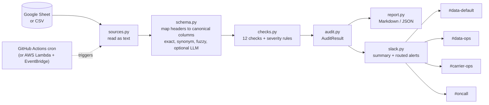

# Architecture

## Design decisions

- **Everything is read as text.** Nothing is coerced before the checks run, so a bad date is reported, not silently turned into NaT.
- **Rules first, LLM last.** Column mapping is deterministic and testable. The LLM only sees columns the rules could not place, it is opt-in, and a wrong or failed answer is ignored.
- **Fail loudly on structural breaks.** If a required column disappears and cannot be matched, the audit reports `missing_required_columns` as critical instead of quietly skipping the checks that need it.
- **Secrets stay out of config.** Routing config holds the *names* of environment variables; webhook URLs live in env vars or CI secrets.
- **One broken webhook never hides the others.** Each delivery is attempted independently and logged.
