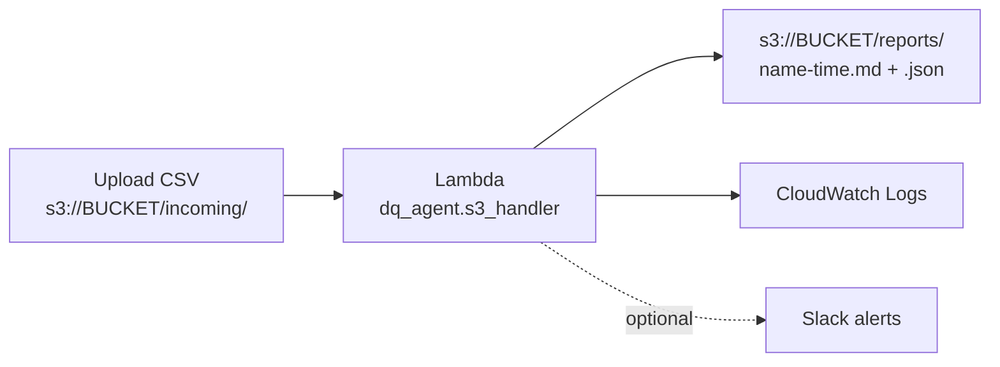

# Deploy to AWS: S3 upload -> Lambda audit -> report in S3



Cost: a small bucket and a few short invocations should be pennies or free-tier, but **set a budget alert first** and **delete everything afterwards** (last section). Use synthetic data only.

AWS console labels change occasionally; if a name below differs slightly, look for the closest match.

## 0. Before you start
- Set a billing alarm: Billing -> Budgets -> create a monthly cost budget (e.g. USD 2-5) with an email alert.
- Pick one region (e.g. Mumbai, `ap-south-1`) and use it for everything.
- Make sample data: `dq-agent generate --rows 500 --drift --out data/sample.csv`

## 1. Build the package
```bash
python aws/build_lambda_zip.py          # use --python 3.13 if you choose 3.13 in step 3
```
This creates `aws/lambda.zip` (about 1.5 MB). pandas is not inside it; you attach it as a layer in step 4.

## 2. Create the S3 bucket
- S3 -> Create bucket, globally unique name, keep **Block all public access ON**.
- Create two "folders" (prefixes) by uploading into them later: `incoming/` and `reports/`.

## 3. Create the Lambda function
- Lambda -> Create function -> Author from scratch.
- Runtime: **Python 3.12**, architecture **x86_64** (must match the build and the layer).
- Upload `aws/lambda.zip` (Code -> Upload from -> .zip file).
- Runtime settings -> Edit -> Handler: `dq_agent.s3_handler.lambda_handler`
- Configuration -> General: memory **512 MB**, timeout **60 sec**.

## 4. Add the pandas layer
- Function page -> Layers -> Add a layer -> **AWS layers** -> pick **AWSSDKPandas-Python312** (latest version).
- If you used another Python version, pick the matching layer. A mismatch is the most common failure.

## 5. Give it least-privilege S3 access
- Configuration -> Permissions -> click the execution role -> Add permissions -> Create inline policy -> JSON.
- Paste `aws/iam-policy.json` and replace `YOUR-BUCKET-NAME` with your bucket name.
- Logging to CloudWatch is already covered by the role Lambda created for you.

## 6. Test it manually
- Upload `data/sample.csv` to `incoming/sample.csv` in your bucket.
- Lambda -> Test tab -> new event -> paste `aws/test-event.json` (with your bucket name) -> Test.
- Expected: status 200, a result with `"status": "FAIL"`, and two new files in `reports/`.

## 7. Make it automatic
- Lambda -> Add trigger -> S3 -> your bucket -> event type "All object create events".
- **Prefix `incoming/`**, suffix `.csv`. Acknowledge the recursion warning: the function writes only to `reports/`, never `incoming/`, so it cannot loop.
- Upload another CSV to `incoming/` and watch `reports/` fill up on its own.

## 8. Collect your proof
- Monitor -> View CloudWatch logs: the "Auditing s3://..." and "Audit complete" lines.
- S3 -> `reports/` -> open the `.md` report.
- Screenshot or record both. Hide your account ID and the bucket name.

## 8b. Try the failure handling
- Upload an **empty file** named `empty.csv` to `incoming/`. Expected: no crash, and `reports/empty-....error.json` saying "file is empty".
- Logs show an `input_rejected` line (level WARNING). A real outage would show `audit_failed` (ERROR) instead.
- Each good run also writes `...-errors.csv`: every bad row with its spreadsheet row number.
- Query the structured logs: CloudWatch -> Logs Insights -> select `/aws/lambda/dq-audit` ->
  `fields @timestamp, key, status, sla_met, error_rate | filter event = "audit_complete"`

## Things that commonly break (good material for the reel)
| Error | Usual cause | Fix |
|---|---|---|
| `No module named 'pandas'` / `ImportModuleError` | Layer missing, or Python/architecture mismatch | Re-add the matching layer |
| `AccessDenied` on GetObject or PutObject | Wrong bucket name or path in the IAM policy | Fix `YOUR-BUCKET-NAME`, check the `incoming/*` and `reports/*` paths |
| `Task timed out` | Default 3 sec timeout | Set timeout to 60 sec |
| `Handler ... not found` | Typo in the handler string | `dq_agent.s3_handler.lambda_handler` |
| Nothing happens on upload | Trigger prefix/suffix doesn't match the key | Upload to `incoming/` with a `.csv` name |

## 9. Clean up (do this the same day)
1. Delete the S3 trigger, then the Lambda function.
2. Empty and delete the S3 bucket.
3. Delete the CloudWatch log group `/aws/lambda/<function-name>`.
4. Delete the IAM role and inline policy created for the function.
5. Check Billing again the next day.

## Optional: Slack alerts from Lambda
Set environment variables on the function: `DQ_SEND_SLACK=1` and `SLACK_WEBHOOK_URL=<your webhook>`.
Treat the webhook like a password; for anything beyond a demo, store it in AWS Secrets Manager.
